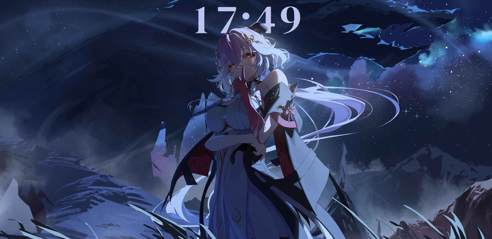

# 🌌 Depthscape

> Depth-aware wallpaper occlusion for **Dux Shell (dux)** on Wayland (Niri).

Depthscape estimates wallpaper depth locally to place desktop background widgets behind wallpaper subjects (iOS-style depth effect).

---

### 🖼️ Depth Occlusion


---

> [!WARNING]
> Desktop widget occlusion requires the background layer feature introduced in [dux-shell PR #4162](https://github.com/duxlabs-dev/dux-shell/pull/4162) (or dux-shell builds incorporating this branch). Standard dux-shell releases without background layer support will display widgets without occlusion.

---

## ✨ Features

- 🖼️ **Depth Occlusion**: Desktop background widgets sit naturally behind foreground wallpaper subjects.
- 🧠 **Local & Offline Inference**: Depth Anything V2 Small runs on-device. The engine and model are provisioned automatically on first launch — no manual download.
- 🖥️ **Per-Display Customization**: Independent controls for occlusion threshold and edge feathering per monitor.

---

## 📋 Requirements

- **Dux Shell (dux-shell)** 2.0+ (with [PR #4162](https://github.com/duxlabs-dev/dux-shell/pull/4162) desktop widget background layer support)
- **Niri** compositor (25.05+)
- **curl**, required to download the engine and models automatically.
- *Optional, only to build the engine yourself*: **Rust & Cargo**.

---

## ⚙️ Niri Configuration

Add the following rule to your Niri configuration (`~/.config/niri/config.kdl`):

```kdl
layer-rule {
    match namespace="^depthscape:"
    place-within-backdrop true
}
```

This rule keeps Depthscape's surfaces in the shared backdrop alongside the desktop
widgets. When it is missing the plugin logs a warning and its surfaces are not placed
in that shared context.

---

## 🚀 Quick Start

### 1. 📦 Install Plugin

Link Depthscape into your dux plugins directory:

```bash
ln -s "$(pwd)" ~/.config/dms/plugins/depthscape
dms restart
```

If Depthscape is also installed through the plugin registry, remove that copy first — a managed install is updated with git, and a failed pull makes DMS re-clone into that path, replacing your link.

### 2. 🚀 First Launch

There is nothing to install by hand. On first start Depthscape downloads the
prebuilt engine and the Depth Anything V2 Small model (~99 MB), and reports progress with a toast. The engine is a single
self-contained binary, so no system packages are needed.

To build the engine yourself instead:

```bash
cd engine && cargo build --release
cp target/release/depthscape-engine ../bin/depthscape-engine
```

*(You can also use **Build Engine** in the plugin’s Engine card, which appears when the engine is missing.)*

### 3. 🎛️ Configure

Open **Dux Settings → Plugins → Depthscape**:

1. Turn on **Depth Wallpaper** to place desktop background widgets behind the wallpaper subject.
2. Adjust **Occlusion Threshold** and **Edge Feather** per display if the foreground split is not where you want it.

---

## 🗃️ What Gets Cached

Only the wallpapers currently shown on some display are kept. When a wallpaper
changes, the previous wallpaper's depth map, mask and palette are
deleted, so memory and disk use stay bounded no matter how many wallpapers you try.

The trade-off is deliberate: every switch re-runs inference. The occlusion effect
reappears after roughly a second; during that window the wallpaper is shown without its depth effect. This
also applies to wallpaper cycling, where every new image is analysed from scratch.

Everything lives in `.data/` next to `plugin.json` (models, caches, runtime files),
so uninstalling the plugin removes it all.

---

## 💻 Useful Commands

All features can be queried or triggered via dux IPC:

```bash
# Re-analyze current wallpaper(s)
dms ipc call depthscape generate

# Query daemon status and surface health
dms ipc call depthscape debug

# Clear depth cache
dms ipc call depthscape clearCache

# Delete all downloaded models and cache data
dms ipc call depthscape uninstall
```

---

## 🙏 Acknowledgements & References

Depthscape builds upon ideas and implementations from the open-source community:

- **Depth Occlusion**: Inspired by [noctalia-dev/wallpaper_depth](https://github.com/noctalia-dev/official-plugins/tree/main/wallpaper_depth).

---

## 📄 License

MIT
