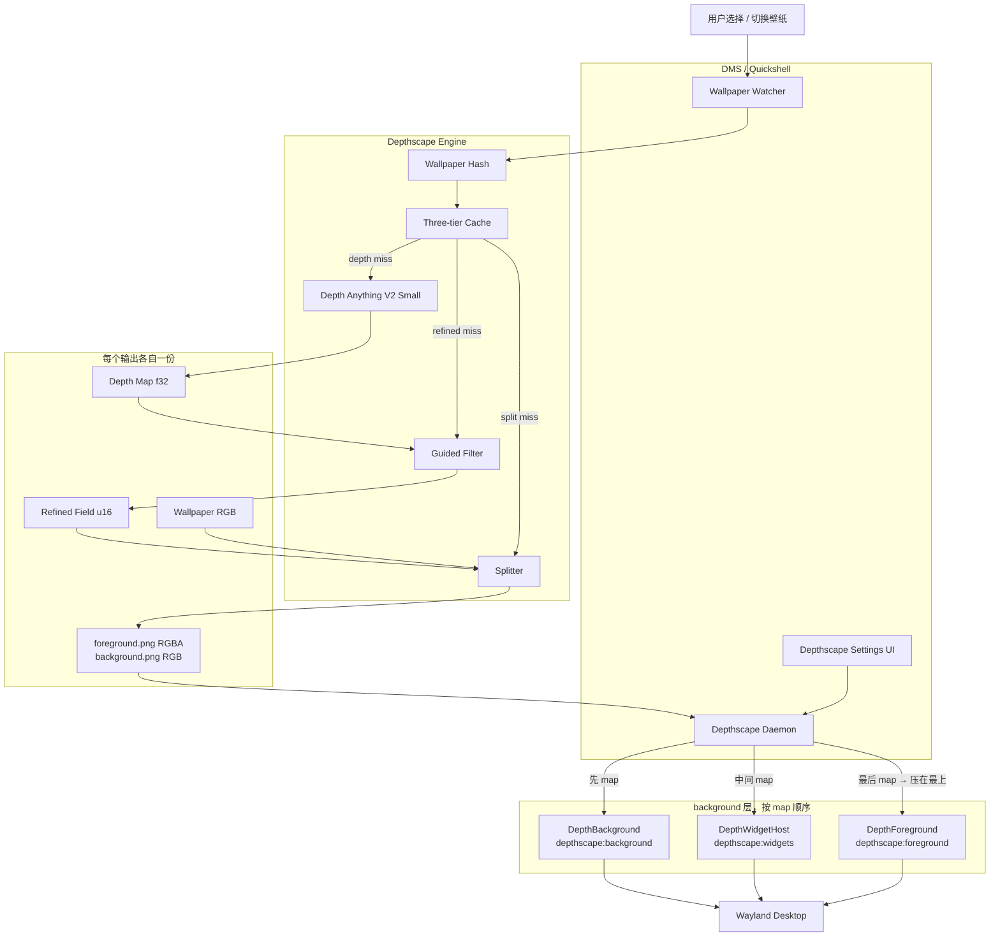

# depthscape

> **AI-powered depth-aware and interactive wallpapers for DankMaterialShell**  
> 面向 DankMaterialShell 的 AI 景深交互壁纸系统。

---

## 1. 项目简介

**depthscape** 是一个面向 DankMaterialShell（DMS）的景深壁纸与交互壁纸扩展项目。

项目目标不是简单地“播放动态壁纸”，而是将普通 2D 壁纸解析为具有前景、背景和深度信息的桌面场景，并利用 DMS / Quickshell / QtQuick 的桌面渲染能力实现：

- 前景人物遮挡桌面组件；
- 类 iOS 锁屏的景深效果；
- AI 自动深度估计（**不做主体分割**，见 §14.2）；
- 导航驱动的 2.5D 视差；
- 基于深度图的 Shader 效果；
- 可选的粒子、音频响应和场景交互；
- 多显示器独立壁纸与独立缓存。

项目遵循一个核心原则：

> **AI 只在壁纸变化时执行一次，桌面运行阶段只进行轻量级 GPU 合成与动画。**

这使得depthscape 能在保留视觉效果的同时，避免持续进行 AI 推理带来的 CPU/GPU 占用和功耗问题。

---

## 2. 项目定位

DMS Depthscape 不只是一个壁纸选择器，也不只是 `mpvpaper` 的前端。

它更接近一个运行在 DMS 上的：

```text
AI Wallpaper Scene Engine
```

整体能力规划如下：

```text
DMS Depthscape
│
├── Wallpaper Source
│   ├── Local
│   ├── Pixiv
│   ├── Wallhaven
│   └── Other Providers
│
├── AI Analysis
│   ├── Depth Estimation
│   ├── Guided Refinement
│   └── Foreground / Background Split
│
├── Depth Effects
│   ├── Widget Occlusion
│   ├── Background Fill
│   ├── Multi-layer Composition
│   └── Depth-aware Blur
│
├── Interactive Effects
│   ├── Mouse Parallax
│   ├── Click Ripple
│   ├── Particle Effects
│   └── Character Interaction
│
├── Reactive Effects
│   ├── Audio Reactive
│   ├── Time Reactive
│   ├── Weather Reactive
│   └── Workspace Reactive
│
└── DMS Integration
    ├── Desktop Widgets
    ├── Theme
    ├── Settings
    ├── Multi-monitor
    └── Wallpaper Lifecycle
```

---

## 3. 核心使用场景

### 3.1 iOS 风格主体遮挡

用户选择一张人物壁纸后，系统自动识别前景主体：

```text
Original Wallpaper
        │
        ▼
Depth Estimation
        │
        ▼
Foreground / Background Split
        │
        ├──► foreground.png   （主体，straight alpha）
        └──► background.png   （填充后的背景，不透明）
```

桌面最终采用如下分层（三个 surface 都落在 layer-shell 的 `bottom` 层，
按 map 顺序自下而上）：

```text
DepthForeground     ← 主体，straight alpha
        ↑
DepthWidgetHost     ← 自研 clock 等桌面组件
        ↑
DepthBackground     ← 填充后的背景（不透明）
```

从而形成：

```text
              14:32
           ┌─────────┐
           │ Weather │
           └─────────┘
               ███
            █████████
           █  Character █
            █████████
```

主体头部、头发或身体可以自然遮挡部分时间和 Widget，形成类似 iOS 景深锁屏的视觉效果。

注意：DMS 自带的壁纸（`WallpaperBackground.qml`）与我们画的背景是同一张图，
两者叠在一起时前景会完全不可见（推导见 §14.2）。因此**启用 Depthscape 时要关掉
DMS 自己的壁纸**。

---

### 3.2 AI 自动景深

对于没有人工分层的普通图片，Depthscape 使用单目深度估计模型生成 Depth Map：

```text
Wallpaper
    │
    ▼
Depth Model
    │
    ▼
Depth Map
    │
    ├── Near
    ├── Mid
    └── Far
```

深度图可用于：

- 自动拆出前景与背景（§14.2）；
- 控制 Widget 遮挡；
- 导航驱动的视差；
- 景深模糊；
- 多层位移；
- Shader 效果。

---

### 3.3 2.5D 视差

切换 workspace / column 时，按相对深度施加不同方向的位移：

```text
niri 导航事件
    │
    ▼
累计偏移（钳制在 maxTravel 内）
    │
    ├── Foreground: +offset
    └── Background:  reverse
```

最终形成近景移动快、远景移动慢的空间感。

---

## 4. 总体架构

> **V0.3 起，引擎拆图，不再输出遮罩。** 见 §14.2 的论证：只给遮罩在数学上
> 无法产生遮挡效果。下面这张图描述的是当前实现。



三层的堆叠关系是这套实现的核心。`background` 层的 surface 按 **map 顺序**
堆叠，最后 map 的在最上，而 wlr-layer-shell **没有 raise 请求**——所以
`DepthDaemon` 必须**分阶段**（stage 0→3，每 32ms 一步）把三个窗口交给
compositor，否则顺序不确定。这是实测结论，不是推断，见 §14.1。

`DepthWidgetHost` 是 Depthscape **自研**的 widget 宿主，不是 DMS 的桌面
Widget。DMS 的桌面 Widget 在 `bottom` 层（严格高于 `background`），永远不会
被主体遮挡，且会被复制进 overview 的每个 workspace card。见 §14.1 与 §14.5。

---

## 5. 运行流程

### 5.1 壁纸发生变化

```text
DMS Wallpaper Changed
        │
        ▼
DepthDaemon / WallpaperWatcher
        │
        ▼
计算壁纸 Hash
        │
        ▼
检查缓存
        │
   ┌────┴────┐
   │         │
命中缓存    未命中
   │         │
   │         ▼
   │      AI 推理
   │         │
   │         ▼
   │    生成 Depth / Refined
   │         │
   └────┬────┘
        ▼
加载场景资源
        │
        ▼
DMS Desktop Rendering
```

### 5.2 正常桌面运行

正常桌面状态下不再调用 AI 模型：

```text
Cached Depth / Refined / Split
            │
            ▼
       QtQuick / GPU
            │
            ├── Widget Occlusion
            ├── Parallax
            ├── Shader
            └── Animation
            │
            ▼
         Display
```

---

## 6. 技术栈

### 6.1 技术栈总览

| 层          | 技术                          | 用途                             |
| ---------- | --------------------------- | ------------------------------ |
| Shell 宿主   | **DMS**                     | 插件生命周期、主题、配置                   |
| UI         | **QML / QtQuick**           | 设置页、预览、前景渲染                    |
| Shell API  | **Quickshell**              | Process、Wayland surface、DMS 集成 |
| 插件形式       | **DMS Composite Plugin**    | Daemon + Desktop + Settings    |
| 核心后端       | **Rust**                    | 模型调用、深度图、拆图、缓存               |
| AI Runtime | **ONNX Runtime**            | 本地推理                           |
| V1 模型      | **Depth Anything V2 Small** | 单目深度估计                         |
| 图像处理       | Rust `image` 等 crate        | resize、split、blur、RGBA        |
| 缓存 Hash    | **BLAKE3**                  | 壁纸/model/参数缓存键                 |
| 配置交换       | **JSON**                    | QML ↔ Rust                     |
| V1 通信      | Process + stdin/stdout      | 简单稳定                           |
| V2/V3 通信   | Unix Domain Socket          | 实时视差/长期 daemon                 |
| V3 GPU     | **WGSL + wgpu**             | 2.5D / Parallax / Shader       |

V1 **不引入任何额外 QML 模块**。合成所需的 `MultiEffect`（仅用于 overview
模糊）来自 stock Qt 的 `QtQuick.Effects`；前景与背景就是两张普通
`Image`，靠 layer-shell 的 map 顺序堆叠（§14.1）。历史上曾需要
`Qt5Compat.GraphicalEffects` 的 `OpacityMask` 来合成遮罩，拆图方案落地后
该依赖已删除（原因见 §14.2）。

### 6.2 核心后端选定 Rust

AI 处理链路（模型调用、深度图、精修、拆图、缓存）全部放在独立的 Rust 可执行文件
`depthscape-engine` 中，而不是 Python 脚本。

理由：

- **无解释器依赖**：用户机器不需要装 Python，也不需要引导 venv、下载 wheel；
  安装即一个静态链接的二进制；
- **启动成本低**：每次换壁纸都要拉起一次进程，Python 解释器 + numpy + onnxruntime
  的导入开销在秒级，Rust 可以压到毫秒级；
- **内存可控**：99 MB 模型 + 中间张量的驻留内存可预测，不会因为 GC 抖动影响 shell；
- **崩溃隔离**：引擎进程崩溃不会带走 DMS 会话。

代价是编译期依赖变重（ONNX Runtime 绑定 + 图像库），但复杂度被留在构建阶段，
而不是留在用户机器上。

### 6.3 进程边界与通信演进

```text
V1   Process + stdin/stdout      一次调用一次进程，无状态
V2   Unix Domain Socket          常驻 daemon，双向请求/响应
V3   Unix Domain Socket + 共享内存  视差等高频交互
```

V1 刻意选择「短进程 + 标准流」：

- 无状态，每次调用自带全部参数，调试时可直接在终端手敲；
- 输出单行 JSON，QML 侧解析即可，无需处理粘包与缓冲；
- 引擎异常退出时 shell 只需丢弃本次结果，不存在连接状态残留。

当 V3 引入鼠标视差后，交互频率会从「换壁纸时一次」变成「鼠标移动时每帧」，
进程模型不再合适，此时升级为 UDS 常驻 daemon；若届时仍受 IPC 开销限制，
再考虑共享内存传递深度纹理。

### 6.4 缓存 Hash 使用 BLAKE3

缓存键（壁纸内容 / 模型指纹 / 参数组合）统一使用 BLAKE3：

- 壁纸文件动辄数 MB 到数十 MB，且**每次切换壁纸都要计算一次哈希**；
- BLAKE3 具备 SIMD 并行与多线程能力，吞吐显著高于 SHA-256；
- 输出 256 位，作为缓存键足够。

例外：**模型文件的完整性校验仍使用上游发布的 SHA-256**。
Depth Anything V2 Small 的官方发布值可以直接人工核对，且与 Hugging Face
页面上的信息对齐；用 BLAKE3 会让这个校验值失去外部可验证性。

### 6.5 AI 阶段与渲染阶段的边界

技术栈严格对应两个互不重叠的阶段：

```text
AI 阶段（Rust + ONNX Runtime）
    壁纸变化 → 推理 → 深度图 → 精修 → 拆图 → 落盘缓存
    低频、可阻塞、允许秒级耗时

渲染阶段（QML / QtQuick，V3 起为 WGSL + wgpu）
    缓存资源 → GPU 合成 → 遮挡 / 视差 / Shader
    高频、不可阻塞、目标 60fps
```

Rust 侧永远不参与逐帧渲染，QML 侧永远不参与 AI 推理。
V1/V2 的实时效果走 QtQuick Scene Graph 与 ShaderEffect；
只有在 V3 需要深度驱动的自定义着色器管线时，才引入 WGSL + wgpu。

---

## 7. 模块设计

### 7.1 WallpaperWatcher

负责监听 DMS 当前壁纸变化。

职责：

```text
Wallpaper Changed
      ↓
resolve path
      ↓
calculate hash
      ↓
request analysis
```

不负责 AI 推理。

---

### 7.2 DepthEngine

独立的 Rust 模块，编译为单个可执行文件 `depthscape-engine`。
它只负责把壁纸拆成前景与背景两张图，不参与渲染，也不与合成器通信。

输入：

```text
wallpaper.png / jpg / webp
```

输出（全部落在插件数据目录，由引擎自行管理）：

```text
cache/depth/<key>.dsc      模型原始输出，f32，推理分辨率
cache/refined/<key>.dsr    精修后的深度，u16，精修分辨率
cache/split/<key>-fg.png   主体，straight-alpha RGBA，输出分辨率
cache/split/<key>-bg.png   背景，RGB（不透明），输出分辨率
```

接口：

```bash
depthscape-engine analyze --wallpaper <path> --threshold 0.30 --feather 0.08
```

返回单行 JSON：

```json
{
  "foregroundPath": "...",
  "backgroundPath": "...",
  "wallpaperPath": "...",
  "width": 5120,
  "height": 2880,
  "outputWidth": 1920,
  "outputHeight": 1080,
  "depthCacheHit": true,
  "refinedCacheHit": true,
  "splitCacheHit": false,
  "elapsedMs": 458,
  "timings": {
    "hashMs": 1, "decodeMs": 81, "depthMs": 0,
    "refineMs": 1, "splitMs": 372, "pruneMs": 0
  }
}
```

> `width` / `height` 是壁纸尺寸，`outputWidth` / `outputHeight` 是拆图尺寸。
> 拆图按细化分辨率输出，因此通常**小于**壁纸（见 §11）；
> 两个 surface 按同一比例缩放即可，不需要两者相等。

> **`-fg.png` 是 straight alpha，不是预乘；`-bg.png` 是 RGB 而非 RGBA。**
> 两者都是刻意的，理由与失效模式见 §14.2——那里的推导比这里重要得多。

> 三级缓存的 key 各自独立：**精修只依赖深度场**，**拆图才读 threshold /
> feather**。所以拖滑块只重跑 split，不重跑模型也不重跑精修。

V1 采用「一次调用一次进程」：无状态、可直接在终端手敲调试、
引擎崩溃不影响 shell 会话；输出单行 JSON，QML 侧无需处理粘包。

---

### 7.3 CacheManager

缓存分三级，因为三种产物被重新计算的频率差了两个数量级：
换壁纸要重算全部，改参数只该重算最后一层。

```text
$XDG_DATA_HOME/depthscape/cache/
├── depth/<key>.dsc           模型输出（f32）      保留 8
├── refined/<key>.dsr         精修深度（u16）      保留 4
└── split/<key>-fg.png        主体（RGBA）        保留 32
    split/<key>-bg.png        背景（RGB）         与 fg 同 key
```

键的构造（哈希算法为 BLAKE3）：

```text
depth   = BLAKE3(壁纸内容) - 模型指纹 - d<depth pipeline 版本> - i<推理尺寸>
refined = depth - r<depth pipeline 版本>                               (.dsr)
split   = depth - v<split pipeline 版本> - t<threshold> - f<feather>   (-fg/-bg.png)
```

两个关键点：

1. **模型指纹取模型文件自身的哈希前缀**，而不是仓库 revision 字符串。
   前者能捕获任何导致权重变化的替换，后者不能。
2. **`refined` 层与 threshold / feather 无关**，因此拖动滑块既不会重跑模型，
   也不会重跑 guided filter——这是三级拆分存在的全部理由。
   参考项目只拆了两级，滑块每动一次仍要付一次完整精修。

清理按 `mtime` 倒序做 LRU；写入一律先落临时文件再 `rename`，
保证读到的要么是完整的旧版本，要么是完整的新版本。

> 缓存放 `$XDG_DATA_HOME` 而不是 `~/.cache`：拆图是用户显式要求生成、
> 且重新生成代价较高的产物，不该被系统清理工具当成可随意丢弃的临时文件。

---

### 7.4 Splitter

根据精修后的深度场，把壁纸拆成前景与背景两张图。**不输出遮罩**（§14.2）。

主要参数：

```text
Depth Threshold     归一化深度阈值，0–1（CLI）／百分比（设置页）
Feather             边缘过渡半宽，0–0.5
```

流程：

```text
Refined Depth (u16)
      ↓
归一化 → smoothstep(threshold ± feather/2)  得到覆盖度 α
      ↓
dilate(α, FILL_DILATE_PIXELS)               得到填充覆盖率
      ↓
box_blur_rgb(source, r, 3 passes)           近似高斯，用于填洞
      ↓
┌─ foreground: 像素原色 + α 进 alpha        （straight，不预乘）
└─ background: α<1 处取原色，α=1 处取模糊填充（硬阶跃）
```

两个容易被做错的地方，都有回归测试钉住：

- **填充用膨胀后的覆盖率，不是原始 α**。α 在轮廓处是半透明，直接在那里
  填充会把正在被移除的像素平均进去，沿轮廓留下一圈主体色光晕。
- **填充按硬覆盖率（α≥1）混合，不按软 α**。理由见 §14.2，
  软混合会沿羽化边缘把主体留在背景里。

`FILL_BLUR_FRACTION = 0.06`（相对短边）、`FILL_BLUR_PASSES = 3`、
`FILL_DILATE_PIXELS = 4`。高斯用三次 box blur 近似——单次 box blur 在半径
尺度上有方块状伪影，三次收敛到真高斯 3% 以内。

> 改这里的任何一步都要 bump `SPLIT_PIPELINE_VERSION`。

---

### 7.5 Compositor（三个 surface）

负责实时桌面效果。三个 `PanelWindow` 全在 **`bottom` 层**（放 `background`
会被 DMS 的 Widget 盖住，放 `top` 会盖住普通窗口），按 map 顺序叠，
由 `DepthDaemon` **分阶段**（stage 0→3）映射。

**为什么必须分阶段**：同一组件树里的多个 `PanelWindow` 是同时创建的，
各自按 Wayland 对象就绪时机**异步 map**，声明顺序不保证等于 compositor
看到的顺序；多屏时 `Variants` 的 delegate 还会互相交错。
症状是**前景渲染完全正确却被压在背景之下**——不透明像素处的截图值精确
等于背景值。因此每个输出一个 `stage`，`stageTimer` 每 32ms 推进一步。

```text
DepthBackground     background.png        主体被挖掉的场景
      ↓
DepthWidgetHost     自研 widget（如时钟）   主体要遮挡的东西
      ↓
DepthForeground     foreground.png        主体，最后 map → 压在最上
```

`DepthForeground` 是一个纯粹的 `Image`，`DepthBackground` 多一个
`MultiEffect` 用于 overview 模糊。**没有 `OpacityMask`、没有
`Qt5Compat.GraphicalEffects` 依赖**（§14.2）。

#### overview 处理

- **背景**：保持 map，按 DMS 自己的参数模糊
  （`blur: 0.8` / `blurMax: 75` / `autoPaddingEnabled: false`，
  取自 `WallpaperBackground.qml` 的 `overviewBlurLoader`），
  使 overview 看起来与没有本插件时一致。`autoPaddingEnabled: false`
  是必须的——开着会让 effect 撑大 item，切换 overview 时画面会缩放。
- **widget 与前景**：**隐藏**。`background` 层上不在 backdrop 里的 surface
  会被复制进 overview 的每个 workspace card，而壁纸是一屏一张，
  不该重复；用户的要求也只是"overview 里不需要看到人物"。
- **`inOverview` 从 compositor 轮询**（`niri msg overview-state`，350ms）。
  `NiriService.inOverview` 在插件上下文里读作常量 `false` 且不报错——
  插件拿到的 service 树是残缺的。

V2：

```text
Background (+ 导航偏移 -s·0.35)
      ↓
Widgets
      ↓
Foreground (+ 导航偏移 +s)
```

V3：

```text
Depth Texture
+ RGB Texture
+ Cursor
+ Audio
      ↓
ShaderEffect
      ↓
Interactive Scene
```

---

## 8. DMS 集成设计

推荐将项目设计为 Composite Plugin：

```text
Depthscape Plugin
│
├── Daemon
│   └── 监听壁纸变化与后台分析
│
├── Desktop
│   └── 景深 / 前景渲染
│
├── Settings
│   └── 参数配置
│
└── Optional Widget
    └── 快捷启停 / 当前状态
```

### 设置页面建议

```text
Depthscape
│
├── General
│   ├── Enable Depth Effect
│   ├── Auto Analyze Wallpaper
│   └── Cache Size
│
├── AI
│   ├── Backend
│   └── Model
│
├── Occlusion
│   ├── Threshold
│   ├── Feather
│   └── Preview Split
│
├── Widgets
│   ├── Enable
│   └── Add / Remove
│
├── Parallax
│   ├── Enable
│   ├── Strength
│   └── Max Offset
│
├── Effects
│   ├── Depth Blur
│   ├── Particle
│   └── Audio Reactive
│
└── Displays
    ├── HDMI-A-1
    └── DP-1
```

---

## 9. 项目结构

以下是 V0.1 已落地的实际结构：

```text
depthscape/
├── README.md
├── plugin.json                 DMS Composite Plugin 清单
│
├── qml/                        Shell 侧（QML / QtQuick）
│   ├── DepthDaemon.qml         daemon：壁纸监听、任务队列、三 surface 分阶段映射
│   ├── DepthBackground.qml     bottom 层背景 surface（填充图 + overview 模糊）
│   ├── DepthWidgetHost.qml     bottom 层 widget surface（自研桌面组件）
│   ├── DepthClockWidget.qml    自研时钟组件
│   ├── DepthForeground.qml     bottom 层前景 surface（straight alpha，点击穿透）
│   ├── DepthStatusWidget.qml   desktop：状态卡片
│   ├── DepthSettings.qml       settings：阈值、羽化、动作按钮
│   └── StartupCheck.qml        校验引擎二进制是否存在
│
├── engine/                     Rust 侧
│   ├── Cargo.toml
│   └── src/
│       ├── main.rs             CLI 分发（status / setup / analyze / clear-cache）
│       ├── config.rs           路径、模型指纹、pipeline 版本与常量
│       ├── protocol.rs         与 QML 交换的 JSON 结构
│       ├── cache.rs            BLAKE3 三级缓存、原子写入、LRU 裁剪
│       ├── imageops.rs         积分图 box_mean、guided filter、smoothstep
│       ├── depth.rs            ONNX Runtime 推理与归一化
│       ├── model.rs            模型下载与 SHA-256 校验
│       └── pipeline.rs         端到端编排：深度 → 精修 → 拆图
│
├── tools/
│   └── make-preview.py         浏览器内的分层预览，免重启 shell 检查效果
│
└── docs/
    ├── depthscape.md           本文件
    └── reference/
        └── noctalia-wallpaper-depth.md   参考项目对照分析
```

运行期产物（不在仓库内）：

```text
$XDG_DATA_HOME/depthscape/
├── models/depth-anything-v2-small/model.onnx
├── cache/depth/       *.dsc       模型输出，f32，推理分辨率
├── cache/refined/     *.dsr       精修深度，u16，精修分辨率
├── cache/split/       *-fg.png    主体，RGBA straight alpha
│                      *-bg.png    背景，RGB 不透明
├── widgets.json                   桌面 widget 布局（绕开 savePluginData）
└── runtime/generate.lock
```

> 后续版本新增的能力（视差、Shader）应扩展 `qml/DepthForeground.qml` 与 `imageops.rs`，
> 而不是引入新的顶层目录。

---

## 10. 版本路线

### V0.1 — Depth Effect MVP

目标：实现最小可用的 iOS 风格景深效果。

功能：

- [ ] 监听 DMS 壁纸变化
- [ ] AI 深度估计（不做主体分割，§14.2）
- [ ] 拆出前景与背景两张图
- [ ] 三级缓存 depth / refined / split
- [ ] 前景主体遮挡指定桌面 Widget
- [ ] 基础设置页面
- [ ] 手动重新分析
- [ ] 清除缓存

核心效果：

```text
Wallpaper
   ↓
Clock
   ↓
Character
```

---

### V0.2 — AI Depth

- [ ] Depth Anything 模型
- [ ] Depth Map Preview
- [ ] Threshold 调整
- [ ] Feather 调整
- [ ] Subject + Depth Hybrid Mode
- [ ] 多显示器独立处理

---

### V0.3 — Parallax

- [ ] 鼠标视差
- [ ] 深度相关位移
- [ ] 平滑滤波
- [ ] 最大位移限制
- [ ] Lazy animation
- [ ] Idle 时停止刷新

---

### V0.4 — Depth Shader

- [ ] Depth-aware blur
- [ ] Ripple
- [ ] Lighting
- [ ] Foreground glow
- [ ] GPU shader pipeline

---

### V0.5 — Interactive Wallpaper

- [ ] 点击响应
- [ ] Particle Engine
- [ ] Character interaction
- [ ] Audio reactive effect
- [ ] Workspace reactive effect

---

### V1.0 — DMS Wallpaper Scene Engine

目标：形成完整稳定版本。

```text
Static Wallpaper
+ AI Depth
+ Subject Segmentation
+ Widget Occlusion
+ Parallax
+ Shader
+ Interactive Effects
```

---

## 11. 性能目标

Depthscape 应严格区分 AI 阶段与运行阶段。

### AI 分析阶段

允许短时间占用较高资源：

```text
Wallpaper Changed
      ↓
1 × AI Inference
      ↓
Cache
```

建议目标：

- 1080p / 1440p 壁纸在数秒内完成分析；
- 不阻塞 DMS 主 UI；
- 分析过程异步执行；
- 支持取消旧任务，防止连续换壁纸造成任务堆积。

### 正常运行阶段

目标：

```text
AI inference = 0
```

运行时仅保留：

- GPU texture；
- 前景 / 背景两张图；
- Shader；
- 动画；
- 少量状态更新。

对于视差：

```text
niri 导航事件
→ 更新累计偏移

静止
→ stop / reduce refresh
```

避免无意义的持续高刷新。

### 实测（2026-09-20）

`analyze` 已内建分阶段计时（输出 JSON 里的 `timings` 字段），
所以下表可复现，不依赖 profiler。复现脚本：`tools/bench.py`。
5120×2880 壁纸、模型已就绪、同一台机器取 5 次中位数（冷启动 2 次），
含进程启动与 JSON 解析：

| 场景 | 优化前 | 优化后 |
|---|---|---|
| 三级全命中（重复检查） | 112.2 ms | **3.1 ms** |
| 拆图未命中（拖滑块） | 236.9 ms | **14.9 ms** |
| 精修 + 拆图未命中 | 375.6 ms | **~380 ms** |
| 全部未命中（冷启动） | 1023.5 ms | **893 ms** |

> 拆图比旧的遮罩编码重（要 blur + 编码两张 PNG，实测 `splitMs ≈ 372`），
> 但滑块路径走的是「精修已命中、只重跑 split」，仍在十几毫秒量级。
> 冷启动 458 ms 时 `splitCacheHit: false`、`elapsedMs 458` / `splitMs 372`。

三处改动：

1. **模型校验记忆化。** 原来每次调用都重新对 99 MB 的模型做 SHA-256，
   约 40 ms ——比它保护的整条缓存命中路径还贵。改为在模型旁写一个
   `.verified` 边车文件记录 `(size, mtime_ns, sha256)`，三元组不变就跳过哈希。
   校验和仍是权威：任何改动或截断都会改变 size 或 mtime，从而强制重算。
2. **壁纸延迟解码。** 原来为了拿宽高而整张解码，5K 壁纸要 ~60 ms，
   连纯缓存命中也得付。改为只读文件头取宽高（`image_dimensions`），
   只有真正需要像素的深度/精修两级才解码——而这两级在拆图命中时根本不跑。
3. **拆图按精细化分辨率输出。** 拆图是精修深度场的逐点函数，不可能比它更清晰。
   原来把遮罩上采样回壁纸分辨率再编码：5K 壁纸下是深度场 **7.1 倍**的像素，
   多出来的全是插值。现按细化分辨率（长边 1920）输出，
   `-fg.png` 实测 2.5 MB / 1920×1080 RGBA，`-bg.png` 1.88 MB / RGB。
   QML 侧本来就用 `PreserveAspectCrop` 缩放到输出，且缩放由 GPU 完成。
   该改动把 `SPLIT_PIPELINE_VERSION` 提到 2，旧产物自动失效重算。

剩余成本几乎都在冷启动路径上，且是模型与算法本身：
深度推理 ~672 ms、guided filter ~147 ms、解码 61 ms。
运行期两行已经降到「一次进程调用」的固定开销量级：
壁纸 BLAKE3 约 1 ms，进程启动与参数解析约 2 ms。

---

## 12. 多显示器设计

每块屏幕独立维护：

```text
DisplayState
├── wallpaper
├── depthMap
├── split
├── parallaxState
└── settings
```

示例：

```text
DP-1
└── anime-a.jpg

HDMI-A-1
└── anime-b.jpg
```

Depthscape 不应假设所有显示器使用同一壁纸。

---

## 13. 隐私与安全

AI 分析默认应完全在本地运行：

```text
Wallpaper
   ↓
Local Model
   ↓
Local Cache
```

默认不上传：

- 壁纸原图；
- 深度图；
- 拆图产物；
- 用户桌面截图。

如果未来增加在线模型，应明确作为可选功能，并在 UI 中清楚提示数据流向。

---

## 14. 已知技术难点

### 14.1 Wayland Surface 层级

最核心的问题不是 AI，而是如何稳定实现：

```text
Wallpaper / Background 层
   ↓
Desktop Widgets          ← Depthscape 自研，与主体同层，按 map 顺序被压
   ↓
Foreground Subject       ← 最后 map，压在最上
   ↓
Normal Application Windows
```

QML 中的 `z: 999` 只对同一个 QtQuick scene / surface 内部有效，
不能保证跨 Wayland surface 的 stacking 顺序。这个判断是对的，
但它并不像原先设想的那样需要改动 DMS 核心。

**结论：不需要 patch DMS，靠 layer-shell 的层级 + 同层 map 顺序即可实现。**

> **V0.3 起三个 surface 全在 `background` 层**，不需要任何用户侧 niri 配置。
> 曾经的 `backgroundLayer` 开关随旧架构一起删除——现在不再是
> "前景盖不盖 widget"的取舍问题，而是三层各自有序。

#### 同层堆叠：map 顺序，且必须分阶段

**同层内按 map 顺序堆叠，最后 map 的在最上，且 wlr-layer-shell 没有 raise
请求**——已被 map 上来的 surface 只能通过 unmap + re-map 才能改变顺序。

但**声明顺序不等于 map 顺序**，这是 V0.3 实测到的一条硬约束：

把三个 `PanelWindow` 放在同一组件树里同时创建时，QML 会按各自 Wayland
对象就绪的时机**异步** map，compositor 看到的顺序因此不确定；多屏时
`Variants` 的 delegate 还会互相交错。

**症状很有迷惑性**：前景本身渲染完全正确，但被压在背景之下——
屏幕上只剩填充好的背景，主体完全不可见。此时不透明像素处的截图值
**精确等于背景值**。

**修法：分阶段 map。** 每个输出维护一个 `stage` 0→3，`stageTimer` 每 32ms
推进一步，一次只把一个新窗口交给 compositor，顺序因而确定。
（delegate 自己注册进 `root.surfaceGroups`；不要遍历 `Variants` 的
`children`——它是 C++ 类型，内部结构不在契约里。）

**排查叠序问题的正确手段**：临时把背景层 `visible` 置 `false`，单独看前景。
若前景立刻完美渲染，说明前景没问题、是叠序错了。这比读 `niri msg layers`
快且可信——后者的顺序是**字母序**，不携带任何 z 序信息。

#### 层间顺序

`wlr-layer-shell` 定义的顺序是：

```text
background  <  bottom  <  top  <  overlay
                    ↑
        普通应用窗口由合成器放在 bottom 与 top 之间
```

#### 同层顺序：map 顺序

DMS 的桌面 Widget 落在 **`bottom`** 层，与 depthscape 的三个 surface **同层**，
因此层间顺序不足以定位它们的关系，必须依赖同层排序规则。

**实测结论（niri 26.04 + smithay）：同层内按 map 顺序堆叠，最后 map 的 surface 在最上层。**

机制在 niri 源码里是显式的 —— `src/niri.rs`：

```rust
fn layers_in_render_order(...) {
    // LayerMap returns layers in reverse stacking order.
    layer_map.layers_on(layer).rev().filter_map(...)
}
```

`layers_on()` 来自 smithay 的 `LayerMap`，其 `layers` 字段是
`IndexSet<LayerSurface>`，`map_layer()` 以 `insert` 追加。
`.rev()` 之后按「底 → 顶」的顺序压入渲染列表，于是**后 map 者后画、因而在最上**。

DMS 自己就依赖这条规则，并在源码里写明了 —— `Modules/DesktopWidgetLayer.qml`：

```qml
// Layer surfaces stack by map order, so recreate them in list order on
// reorder/enable/display-pref changes or once a plugin component loads (#2715).
...
// Reversed so the top of the list maps last and renders in front.
values: [...(SettingsData.desktopWidgetInstances || [])].reverse()
```

#### 由此确定的设计约束

**1. 三个 surface 全在 `bottom` 层。** 放 `background` 会被 DMS 的 Widget 盖住，
放 `top` / `overlay` 会盖住普通应用窗口。`bottom` 是唯一能让「背景 < widget <
前景」这条链自洽、又不侵入应用窗口的层级。

> 曾经的 `backgroundLayer` 开关随旧架构一起删除——那是在「前景盖不盖 widget」
> 之间的取舍，因为当时只有一个 surface。现在三层各自有序，不是取舍问题。

**2. 同层内必须抢 map 顺序，且要分阶段。** 见上文「同层堆叠：map 顺序，且必须分阶段」。

`wlr-layer-shell` 没有「raise」请求，唯一手段是销毁并重建 surface
（`unmap` 会把 surface 从 `LayerMap` 中移除，重新 `map` 即追加到末尾）。
DMS 在 Widget 列表变化时会重建它自己的全部 Widget surface，
届时 `bottom` 层上的 depthscape surface 会被压在后面，因此 `DepthDaemon` 监听
`SettingsData.desktopWidgetInstances`，等 DMS 自己的去抖（150ms + 32ms）结束后
再重建整组 surface。

**但 `desktopWidgetInstances` 不是唯一的触发条件。** 读
`DesktopWidgetLayer.qml` 可以看到它有两个去抖入口：

```qml
onOrderSignatureChanged: rebuildDebounce.restart()   // 列表/启用/显示偏好变化
onPluginReadyKeyChanged: rebuildDebounce.restart()   // 插件的桌面组件加载完成
```

`pluginReadyKey` 派生自 `PluginService.pluginDesktopComponents`。
**这条在 shell 每次启动时都必然发生，而且发生在本插件 daemon 映射 surface 之后**
——于是 Widget 会压在前景上，用户看到的效果就是「没生效」。
这个 bug 只有在真实会话里装上插件才会暴露，夹具（三个 surface 同一时刻创建）
测不出来。

修法是监听 DMS 用的同一个属性，再加一个启动兜底：

```qml
Connections {
    target: PluginService
    function onPluginDesktopComponentsChanged() { widgetRebuildTimer.restart(); }
}

// 兜底：上面那条信号可能在本 daemon 构造之前就发过了，
// 冷启动时首个拆图也可能晚于它。延迟再顶一次，两种情况都覆盖。
Timer { interval: 3000; running: true; repeat: false
        onTriggered: root.raiseSurfaces() }
```

兜底是无害的：如果 surface 尚未 map，`raiseSurfaces()` 是空操作；
而拆图就绪时 surface 自然会最后 map、因而在最上。

日常主路径不需要额外处理：换壁纸时 `foregroundPath` 先被清空、当前
`stageTimer` 会重跑一轮，新图就绪后重新 map，自然处于最上层。

时间预算：DMS 在 `orderSignature` 变化后先等 `rebuildDebounce` 150ms、
再等 `rebuildApply` 32ms 才把 `rebuilding` 置回 `false`，其新 surface
大约在 182ms 时 map；depthscape 等到 400ms 再动，加自身分阶段映射
（3 步 × 32ms ≈ 96ms），约 496ms 时最后一个 surface 落地。两者都由同一个
属性变更信号触发，因此**顺序是常量保证的**，不依赖调度时序。
取 400ms 而非贴着实测值，是为了给 Qt 创建 surface 留出余量。

#### 点击穿透

前景 surface 必须完全不接收输入，否则会挡住桌面 Widget 的点击：

```qml
mask: Region {}          // 空输入区域 = 完全点击穿透
```

`Region {}`（不含 `item`）即空输入区域。这与 DMS 自身用法一致
（`DesktopPluginWrapper.qml` 的 `emptyMask` 与桌面 Widget 网格覆盖层）。

#### 实测记录：叠序与视觉确认（2026-09-20）

**隔离手段**：把 `showBackground` 临时置 `false`，单独看前景。前景立刻
完美渲染（`(1250,1000)` → `(8,5,42)`，正是前景自己的颜色）→ 证明前景本身
没问题，是叠序错了。分阶段 map 落地后重新验证：

- **8/8 采样点精确匹配**：α=255 处截图值 == 前景色 `(8,5,42)`；
  α=0 处 == 背景色 `(173,12,43)`。
- **背景泄漏仅 0.2%**：主体区 90.1% 的像素可解释为前景色或某个**邻居前景像素**
  （亚像素采样）；剩余部分主要是 DMS 自带时钟压在主体之上。
- **时钟遮挡**：时钟框内 403 个被主体覆盖的采样点，**0 个**仍露出时钟粉色。
- **视觉**：Itachi/crow 剪影实心不透明；`0:05:17` 被电线杆干净切断后从
  另一侧重现；暗红天空与白月亮处**无接缝**。

> **判据不能用「不透明处 == 前景色」这种单点断言**。DMS 自己的 clock 在
> `bottom` 层画在主体之上，大号数字处会假阳性（实测 `(1198,532)` 期望
> `(2,4,41)` 实得 `(255,179,181)`）。正确判据是「等于前景色**或某个邻居
> 前景像素**」，再单独断言没有任何像素等于背景色。
> 区分背景泄漏与时钟覆盖看色相：天空是 `(173,12,43)` **暗红**，
> 时钟是 `(255,179,181)` **浅粉**/白，一亮一暗。

> 截图必须**每次确认输出**：`focus-monitor-left` 在截图动作本身会挪焦点，
> 本轮曾在 DP-3 上按 DP-1 坐标验证，得到「0% 匹配」的垃圾结论。
> 3840×2160 = DP-1，2560×1440 = DP-3。

#### 仍需确认

- Hyprland / Sway 是否同样按 map 顺序堆叠（两者都基于 smithay，
  预期一致，但未实测；`plugin.json` 的 `compositors` 目前只声明 `["niri"]`）；
- `SettingsData.desktopWidgetInstancesChanged` → 400ms 定时器 → 重建 surface
  这条**触发链路**尚未在真实 DMS 会话中跑到：用户当前的
  `desktopWidgetInstances` 全部 `enabled: false`，要触发就得改动其配置。
- 多显示器逐像素验证（目前只在 DP-1 上做过完整的像素级判据）。

---

### 14.2 拆图：为什么必须输出两张图

**只输出遮罩在数学上不可能产生遮挡效果。** 这是整个项目最重要的一条结论。

设遮罩覆盖度为 `α`，DMS 自己画的壁纸为 `W`。前景 surface 做的是
`α·W + (1-α)·底下`，而"底下"就是**同一张 `W`**：

```text
α·W + (1-α)·W ≡ W
```

主体区域像素完全一致，**画与不画没有区别**。实测：把遮罩对
`α·W + (1-α)·DMS壁纸` 重新合成，与纯壁纸的全屏 MAE 是 **2.19**，
差异只出现在顶栏和时钟文字这些**我们自己画的东西**上——不是主体
（α>0.95 的像素只占 6.2%，其 MAE 3.78；α<0.05 的占 92.9%，MAE 2.07）。

所以引擎输出的是**一对图**：

| 文件 | 格式 | 内容 |
|---|---|---|
| `-fg.png` | **straight-alpha** RGBA | 主体原色 + 覆盖度在 alpha 通道 |
| `-bg.png` | RGB（不透明） | 同一场景，主体区域被**模糊填充** |

`DepthBackground` 画后者、`DepthWidgetHost` 画中间的 widget、
`DepthForeground` 画前者，三层都在 `bottom` 层按 map 顺序叠。

#### 两个必须遵守的约定

**1. 前景是 straight alpha，不是预乘。**

消费者是 QML 的 `Image`，它采样 straight-alpha 源并**自己乘一次 alpha**。
发预乘数据会让 alpha 被应用两次，主体渲染成半透明——
后面的时钟透过轮廓可见。这是实测到的，症状是时钟数字的粉色渗进主体。

判别方法：**透明像素的 RGB 是否为 0**。预乘是 0，straight 不是。

**2. 背景的填充必须用硬覆盖率，不能用软 alpha。**

straight alpha 下合成式是 `α·C_fg + (1-α)·C_bg`，而 `C_fg = C_src`，代入
要求合成结果等于原图：

```text
α·C_src + (1-α)·C_bg = C_src   =>   C_bg = C_src   （对一切 α < 1）
```

**`α < 1` 时背景值是被强制的**，只有 `α = 1` 时方程退化——前景完全覆盖，
背景取任何值都不影响结果。**那个自由度才是拆图的意义**：把模糊填充藏在
不透明的主体下面。

若改用软 alpha 混合填充，就会沿羽化边缘把主体留在背景里，合成时主体被
**加到自己身上**，实测 α=0.5 处漂移 **37/255**，表现为沿轮廓一圈亮色光晕。
回归测试 `the_background_never_retains_the_subject_under_a_soft_edge`
用的激励**必须是软渐变**——硬边缘上 α 只有 0/1，两种公式完全重合，测不出来。

#### 被否掉的历史方案

- **`MultiEffect` + 遮罩**：在 63 个"必须显示壁纸"的采样点上只有 35 点正确，
  28 点露出底色。原因是 `layer.enabled` 作用在不可见 `Image` 上时纹理更新
  不可靠。`OpacityMask` 在同一夹具上 63/63 正确，但它来自
  `Qt5Compat.GraphicalEffects`——一个 DMS 自身不使用的模块，等于给所有用户
  加一个系统依赖。拆图方案下两者都不需要了。
- **引擎直接输出成品图（壁纸 RGB + alpha）**：同一张 5120×2880 壁纸，
  成品 PNG 是 **27 MB**，纯遮罩只有 277 KB。但这个反对理由在拆图方案下
  已经失效——现在输出的是降采样后的 1920×1080，`-fg.png` **2.5 MB**、
  `-bg.png` **1.88 MB**，且 `-bg` 用 RGB 而非 RGBA 又省掉四分之一。
- **`place-within-backdrop`**：把 surface 塞进 backdrop 最底层，
  被同在 backdrop 的 DMS 壁纸和 overview blur 完全盖住（实测 0.0%）。
  且必须由 niri `layer-rule` 按 namespace 显式开启。**本架构不开它，
  也因此不需要任何用户侧 niri 配置。**

---

### 14.3 人物边缘质量

头发、透明材质和细小边缘容易出现：

- 锯齿；
- 白边；
- 过度遮挡；
- 边缘闪烁。

需要通过：

```text
Alpha Matte
Feather
Erode / Dilate
Edge Refinement
```

改善效果。当前实现走的是 `smoothstep` 羽化 + `dilate` + 硬覆盖率填充
（§7.4），**guided filter 是边缘质量的主要来源**（radius 8, epsilon 0.001）。

---

### 14.4 深度估计误差

AI Depth 可能无法正确判断：

- 动漫图片；
- 极简插画；
- 镜子；
- 透明物体；
- 大面积纯色背景。

因此必须允许用户手动调整：

```text
threshold
feather
```

不能完全依赖自动结果。

---

### 14.5 桌面 Widget 拿不到插件的状态 API

`DepthStatusWidget` 一开始写的是：

```qml
status = pluginService.loadPluginState(pluginId, "status", {});
```

在夹具里这样写是对的，作为桌面 Widget 装进真实会话后却永远显示
「Model not installed」——而 daemon 其实一切正常
（`depthscape_state.json` 里 `modelReady: true`、两个输出都是 `ready`）。

原因是 DMS 给桌面 Widget **实例**注入的不是完整的 `PluginService`：

```qml
// DesktopPluginWrapper.qml
item.pluginService = root.isInstance ? instanceScopedPluginService : root.pluginService;
```

`instanceScopedPluginService` 只暴露 `availablePlugins` / `loadedPlugins` /
`pluginDesktopComponents`、`loadPluginData` / `savePluginData` /
`getPluginVariants` / `isPluginLoaded`，以及 `pluginDataChanged` /
`pluginLoaded` / `pluginUnloaded` 三个信号。
**没有 `loadPluginState`，也没有 `pluginStateChanged`。**
调用会静默失败（属性为 `undefined` 的函数调用被吞掉），
`status` 永远是 `{}`。

而 `desktopWidgetInstances` 是桌面 Widget 唯一的创建路径
（`DesktopWidgetLayer.qml` 完全由该列表驱动），所以拿到的**永远**是这个精简包装。
DMS 自己的 `Modules/Plugins/PluginSettings.qml` 也防了这一手：

```qml
if (pluginService && pluginService.loadPluginState)
    return pluginService.loadPluginState(pluginId, key, defaultValue);
```

**解决办法**：直接读自己的状态文件，路径与 `PluginService.getPluginStatePath()`
一致，用 `FileView` 监听变化——这正是 `PluginService` 内部的做法。

```qml
readonly property string stateFilePath: pluginId === ""
    ? ""
    : Paths.strip(Paths.state) + "/plugins/" + pluginId + "_state.json"

FileView {
    path: root.stateFilePath
    blockLoading: true
    watchChanges: true
    onLoaded: root.applyState()
    onFileChanged: reload()
}
```

**不要改用 `savePluginData` 传递状态。** 它写进 `plugin_settings.json`，
会触发 `pluginDataChanged`；而 daemon 自己也监听该信号并调用
`syncParameters()` 使全部拆图失效——两边一连就是死循环。
widget 布局因此改存 `$XDG_DATA_HOME/depthscape/widgets.json`。

> 教训：夹具能证明**机制**，不能证明**集成**。
> 夹具里 `pluginService` 是完整单例，真实会话里是精简包装；
> 夹具里三个 surface 同一时刻创建，真实会话里 Widget 层晚于前景 map。
> 这两个 bug 都只有真正装进 DMS 才会出现。

---

## 15. 参考项目

开发过程中建议重点研究以下思路：

### Noctalia Wallpaper Depth

参考：

- AI depth pipeline；
- depth cache；
- threshold / feather；
- widget occlusion。

### shiftpaper

参考：

```text
Offline AI preprocessing
        +
Realtime GPU rendering
```

这种 AI 与实时渲染完全解耦的设计。

### waydeeper

参考：

- Depth Map；
- GPU Parallax；
- 2.5D scene；
- Shader；
- Wayland wallpaper rendering。

### DMS WallpaperEngine

参考：

- DMS 插件生命周期；
- 壁纸服务集成；
- 多显示器；
- Settings UI；
- 外部后台进程管理。

---

## 16. 开发优先级

不建议一开始做：

```text
Particle
Audio Reactive
3D Mesh
Live2D
Complex Shader
```

第一阶段只验证三个问题：

```text
1. 能否正确监听 DMS 壁纸变化？

2. 能否稳定生成并缓存前景/背景两张图？

3. 能否让前景主体正确遮挡 desktop Widget？
```

只要这三个问题打通，项目的核心技术路径就成立。

---

## 17. MVP 定义

最小可行版本：

```text
选择壁纸
    ↓
深度估计（不分割）
    ↓
拆出 foreground / background
    ↓
Clock Widget
    ↓
主体遮挡 Clock
```

用户最终只需要看到：

```text
           14:32
        ┌────────┐
        │ 26 °C  │
        └────────┘
             ████
          █████████
         █ Character █
          █████████
```

如果这一步的视觉效果、稳定性和性能达标，再继续进入 Depth / Parallax 阶段。

---

## 18. 项目愿景

DMS Depthscape 最终希望将传统 Linux 壁纸：

```text
Static Image
```

升级为：

```text
Depth-aware Desktop Scene
```

让 Wallpaper、Desktop Widget 和用户交互不再是彼此独立的元素，而成为统一的桌面场景：

```text
Wallpaper
+ AI Scene Understanding
+ Desktop Widgets
+ Depth
+ Interaction
+ GPU Effects
=
DMS Depthscape
```

---

## 19. 一句话介绍

> **DMS Depthscape turns ordinary wallpapers into AI-powered, depth-aware interactive desktop scenes for DankMaterialShell.**

中文：

> **DMS Depthscape 将普通壁纸转化为具有 AI 景深、前景遮挡与交互效果的 DankMaterialShell 桌面场景。**
